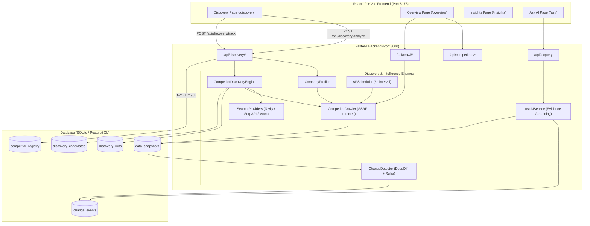

# DriftWatch — Competitive Intelligence & Market Discovery Platform

A full-stack competitive intelligence platform that automatically discovers relevant market competitors from a company website, verifies their offerings, monitors public pages, detects pricing and messaging shifts, and surfaces grounded actionable intelligence.

---

## 🎯 What Problem This Solves

Teams struggle to maintain a continuous, structured view of their competitive landscape:
- Discovering direct, indirect, and adjacent competitors is manual and irregular.
- Competitor websites, pricing tiers, and product messaging change silently without notification.
- Generic AI tools hallucinate competitor details when not grounded in verified web evidence.
- Raw alerts cause fatigue without explainable ranking and change classification.

**DriftWatch** solves this end-to-end:
1. Enter your company URL -> DriftWatch crawls and extracts your structured business profile.
2. DriftWatch searches for competitor candidates, deduplicates domains, verifies live sites, and scores them.
3. Review ranked recommendations with explainable evidence and 1-click promotion to active monitoring.
4. DriftWatch's scheduler continuously crawls tracked competitors, extracts pricing plans, detects changes, and provides evidence-grounded Q&A via Ask AI.

---

## 🚀 Implementation Status (Phase 2 Verified)

| Component / Workflow | Status | Details |
|---|---|---|
| **Company Profiling** | ✅ Implemented & Verified | Crawls homepage, extracts headline, meta, business keywords, pricing model, audience, and confidence score. |
| **Search Provider Adapters** | ✅ Implemented & Verified | Pluggable architecture: `TavilySearchProvider`, `SerpApiSearchProvider`, and `MockSearchProvider`. |
| **Live External Search** | 🟡 Implemented (Awaiting Keys) | Code ready and unit-tested for Tavily and SerpAPI. Falls back to `MockSearchProvider` when keys are omitted. |
| **Mock Search Provider** | ✅ Implemented & Verified | Deterministic canned search results for local offline E2E verification. |
| **Domain Deduplication & Normalization** | ✅ Implemented & Verified | Strips schemes, paths, ports, and subdomains; excludes self-domain and major aggregator platforms. |
| **Candidate Site Verification** | ✅ Implemented & Verified | Asynchronously crawls candidate landing pages, validates HTTP reachable status, extracts live headline/pricing. |
| **Explainable Multi-Signal Ranking** | ✅ Implemented & Verified | Weighted scoring (0–100): keyword overlap (35%), content relevance (25%), industry alignment (20%), pricing signal (20%). |
| **Competitor Classification** | ✅ Implemented & Verified | Classifies candidates into `direct` (≥70), `indirect` (45–69), and `adjacent` (<45). |
| **Explicit Uncertainty Reporting** | ✅ Implemented & Verified | Lists missing evidence (e.g., missing pricing plans, unreachable sites, missing feature matrices). |
| **1-Click Tracking Integration** | ✅ Implemented & Verified | Promotes discovered candidate to `CompetitorRegistry` and triggers active crawler monitoring. |
| **Discovery History & Persistence** | ✅ Implemented & Verified | Stores `DiscoveryRun` and `DiscoveryCandidate` entities with Alembic migration in SQLite/PostgreSQL. |
| **Scheduled Monitoring** | ✅ Implemented & Verified | Background APScheduler runs every 6 hours to crawl tracked competitors. |
| **Change Detection Engine** | ✅ Implemented & Verified | Compares HTML/text snapshots, computes price percentage changes, tracks keyword additions/removals, and logs structured events. |
| **Ask AI Grounded Q&A** | ✅ Implemented & Verified | Answers user questions with strict evidence citations from stored change events and snapshots. |
| **Security & SSRF Guard** | ✅ Implemented & Verified | Strict URL scheme (HTTP/HTTPS) and IP validation (rejects private, loopback, link-local, AWS metadata endpoints). |

---

## 🏗️ Architecture



---

## 🔍 Automated Competitor Discovery Workflow

```
1. Target Website Submission
   └─ User submits URL (e.g., https://yourcompany.com) on the /discovery dashboard.

2. Company Profiling (CompanyProfiler)
   └─ Bounded crawl extracts title, meta description, business keywords, pricing model, and target audience.

3. Search Query Generation
   └─ Synthesizes targeted queries:
      • "top competitors to {company} {industry}"
      • "alternatives to {company} {keywords}"
      • "best companies offering {industry} {keywords}"

4. Candidate Search Retrieval
   └─ Queries configured provider (Tavily, SerpAPI, or Mock fallback).

5. Domain Deduplication & Normalization
   └─ Extracts root domain, strips subdomains/paths/protocols.
   └─ Filters out own domain and aggregators (Google, YouTube, Reddit, Wikipedia, GitHub, etc.).

6. Verification Crawl (CompetitorCrawler)
   └─ Asynchronously verifies candidate landing page availability and extracts live content.

7. Multi-Signal Scoring & Classification
   └─ Computes explainable match score (0–100) across keyword overlap, snippet match, industry, and pricing.
   └─ Classifies candidate as Direct, Indirect, or Adjacent.

8. Uncertainty & Missing Evidence Reporting
   └─ Explicitly lists missing evidence (e.g. unverified landing page, undetected pricing).

9. User Review & 1-Click Promotion
   └─ User reviews recommendations, dismisses noise, or clicks "Track Competitor" to promote candidate into active 6-hour monitoring.
```

---

## 🛠️ Technology Stack

| Layer | Technologies |
|---|---|
| **Frontend** | React 19.2, React Router 7.13, Vite 8.1, Tailwind CSS |
| **Backend** | Python 3.14+, FastAPI 0.115+, Pydantic v2, HTTPX, aiohttp |
| **Data & Persistence** | SQLAlchemy 2.0 (AsyncIO), aiosqlite, asyncpg, Alembic 1.14+ |
| **HTML Parsing & NLP** | BeautifulSoup4, lxml, DeepDiff |
| **Search Providers** | Tavily API adapter, SerpAPI Google adapter, Mock adapter |
| **Scheduling** | APScheduler 3.10+ (AsyncIOScheduler) |
| **Testing & E2E** | pytest 9.1+, pytest-asyncio, Playwright (Chromium) |

---

## 📦 Installation & Setup

### Prerequisites
- Python 3.10+ (tested on Python 3.14.3)
- Node.js 18+ (tested on Node.js 22+)
- SQLite (default development database) or PostgreSQL 15+

### 1. Clone & Environment Setup

```bash
git clone <repository-url>
cd DriftWatch

# Create Python virtual environment
python -m venv venv
# On Windows:
venv\Scripts\activate
# On Linux/macOS:
source venv/bin/activate

# Install backend dependencies
pip install -r requirements.txt

# Setup environment configuration
cp .env.example .env
```

### 2. Configure Environment (`.env`)

```env
DATABASE_URL=sqlite+aiosqlite:///./sirius.db
WEBHOOK_SECRET=your-webhook-secret
PRICE_CHANGE_THRESHOLD_PCT=5.0
ANOMALY_ZSCORE_THRESHOLD=2.5

# Discovery Search Provider ("auto", "tavily", "serpapi", "mock")
DISCOVERY_SEARCH_PROVIDER=auto
DISCOVERY_MAX_CANDIDATES=10

# Optional live search provider keys (leave empty to use MockSearchProvider):
# TAVILY_API_KEY=tvly-xxxxxxxxxxxx
# SERPAPI_API_KEY=xxxxxxxxxxxxxxxx

# Set to True ONLY for running local tests against 127.0.0.1:
ALLOW_LOCAL_CRAWLS=False

# ── Authentication ───────────────────────────────────────────────────────────
# Google OAuth 2.0 (Optional — leave blank to disable Google Sign-In)
# Obtain from Google Cloud Console > APIs & Services > Credentials
GOOGLE_CLIENT_ID=
GOOGLE_CLIENT_SECRET=
GOOGLE_REDIRECT_URI=http://localhost:8000/api/auth/google/callback
# Set to True to allow reading pre-authentication (legacy/global) data
# alongside the current user's own data. Defaults to False.
ALLOW_LEGACY_GLOBAL_READS=False

# Email/Password Authentication
# No additional configuration required — accounts are created via
# the /api/auth/register endpoint. Passwords are hashed with bcrypt.
```

### 3. Database Migrations

Apply Alembic migrations to set up core monitoring and Phase 2 discovery tables:

```bash
alembic upgrade head
```

### 4. Install Frontend Dependencies

```bash
cd frontend
npm install
cd ..
```

---

## 🚀 Running the Application

### Start Backend

```bash
uvicorn app.main:app --port 8000
```
Interactive API documentation: `http://localhost:8000/docs`

### Start Frontend

```bash
cd frontend
npm run dev
```
Dashboard available at: `http://localhost:5173`

### Start Node Notification Service (Optional)

```bash
cd JavaScript
npm install
npm run dev
```
Service runs on `http://localhost:3000` for email/Slack webhook notifications.

---

## 📡 Key API Endpoints

### Automated Competitor Discovery (Phase 2)
| Method | Endpoint | Description |
|---|---|---|
| `POST` | `/api/discovery/analyze` | Profiles target website, searches, verifies, ranks, and returns candidate recommendations. |
| `GET` | `/api/discovery/runs` | Lists historical discovery runs. |
| `GET` | `/api/discovery/runs/{id}` | Retrieves a discovery run by ID with candidates and profile. |
| `POST` | `/api/discovery/track` | Promotes a discovered candidate into the active competitor registry for monitoring. |
| `POST` | `/api/discovery/dismiss/{id}` | Dismisses a discovery candidate. |

### Competitor Monitoring & Crawler
| Method | Endpoint | Description |
|---|---|---|
| `POST` | `/api/competitors/add` | Registers competitor for scheduled crawls (with deduplication). |
| `GET` | `/api/competitors` | Lists all registered competitors. |
| `DELETE` | `/api/competitors/{name}` | Removes competitor from monitoring. |
| `POST` | `/api/crawl/single` | Executes an on-demand crawl and runs change detection. |
| `POST` | `/api/crawl/trigger` | Triggers immediate crawl of all registered competitors. |

### Intelligence & Q&A
| Method | Endpoint | Description |
|---|---|---|
| `GET` | `/api/events` | Retrieves all detected change events across competitors. |
| `GET` | `/api/events/{source_id}` | Retrieves change events for a specific competitor. |
| `POST` | `/api/ai/query` | Ask AI: answers queries with citations grounded in snapshots and change events. |

---

## 🧪 Testing & Verification

The test suite includes unit tests, API contract tests, pipeline lifecycle checks, migrations tests, and headless browser E2E workflows.

### 1. Pytest Test Suite (119 Tests)

```bash
python -m pytest
```
- Covers URL validator & SSRF prevention (30 tests)
- Change detector, price thresholds, keyword shifts (24 tests)
- Extractor normalization, currencies, plans (31 tests)
- Competitor discovery, mock adapter, domain normalization, ranking (6 tests)
- Hardening, webhook secret, DB persistence (5 tests)
- Alembic upgrade, downgrade, idempotency (3 tests)
- Grounded Ask AI queries (5 tests)
- API contracts & SSRF rejection (10 tests)
- Full crawl pipeline lifecycle (5 tests)

### 2. End-to-End Verification Pipeline (9 Steps)

```bash
python scripts/run_e2e.py
```
Launches backend on port 8000, runs against an isolated mock site on port 8088, and verifies:
1. Health check
2. Competitor registration
3. Case-insensitive duplicate rejection
4. Baseline snapshot (0 change events)
5. Unchanged crawl (0 change events)
6. Controlled modified crawl (detects 7 events: price changes, keyword shifts)
7. Dashboard & Ask AI grounded Q&A
8. Unreachable host error handling
9. Persistence post-restart

### 3. Full Browser E2E Suite (22 Checks via Playwright)

```bash
python scripts/browser_e2e.py
```
Verifies the complete React application in headless Chromium:
- Empty states (Overview, Insights, Changes, Ask AI)
- Competitor registration & crawl execution
- Real-time event notifications & Ask AI interaction
- Automated Discovery workflow (/discovery): website input, profile generation, candidate recommendations list
- 1-Click Track integration: promotes discovered candidate to active monitoring
- Console error inspection (0 unexpected errors)

---

## 🔐 Authentication

DriftWatch supports two authentication methods, both using server-side sessions stored in HttpOnly cookies:

### Email / Password
- Register via `/api/auth/register` (POST with email, password, optional display_name)
- Passwords are hashed with bcrypt; never stored in plaintext
- Login via `/api/auth/login`
- Session expires after 24 hours; logout revokes the session server-side

### Google OAuth 2.0
- Obtain credentials from the [Google Cloud Console](https://console.cloud.google.com/apis/credentials)
- Set `GOOGLE_CLIENT_ID`, `GOOGLE_CLIENT_SECRET`, and `GOOGLE_REDIRECT_URI` in `.env`
- The OAuth callback URI is `http://localhost:8000/api/auth/google/callback`
- Users sign in via the "Continue with Google" button on the Login/Register pages

**⚠️ Credentials must never be committed.** The `.env` file is excluded via `.gitignore`. Use `.env.example` as a template and copy it to `.env` with your actual values.

---

## 🔒 Security & Safe Operation

- **SSRF Protection**: All user-supplied crawl and discovery URLs are validated using `app.services.url_validator.py`. Private IPs (`10.0.0.0/8`, `172.16.0.0/12`, `192.168.0.0/16`), loopbacks (`127.0.0.1`), link-local/cloud metadata (`169.254.169.254`), and non-HTTP protocols are strictly rejected.
- **Local Dev Toggle**: `ALLOW_LOCAL_CRAWLS` is `False` by default and only enabled in isolated automated test harnesses.
- **Explainable Scores**: Match scores are computed deterministically from transparent weights without black-box hallucinations.
- **Database Safety**: Production credentials and database files (`sirius.db`) are excluded via `.gitignore`. Isolated databases are used during test runs.

---

## 🗺️ Roadmap (Future Enhancements)

- [ ] Multi-tenant user authentication (OAuth2 / JWT).
- [ ] Live search provider integration verification using verified Tavily / SerpAPI API keys.
- [ ] Review platform scraping (G2, Trustpilot, Capterra).
- [ ] Ad library monitoring (Meta Ad Library, Google Ads Transparency).
- [ ] Email & Slack webhook alerts for critical price changes.
- [ ] Exportable PDF & CSV executive intelligence briefs.

---

## 📄 License

MIT License
